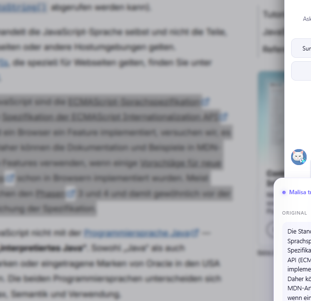
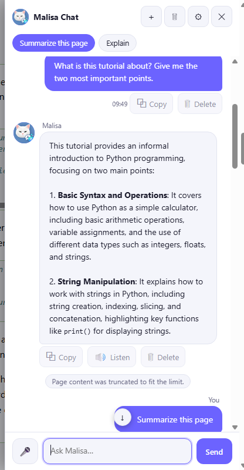
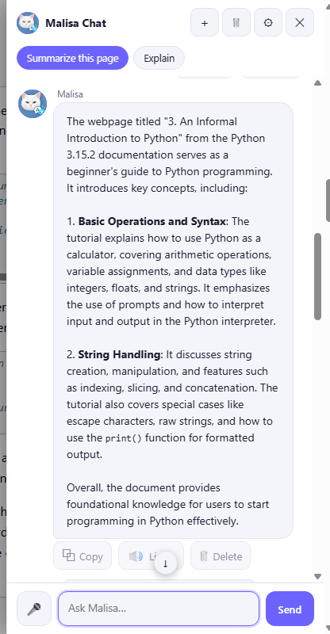
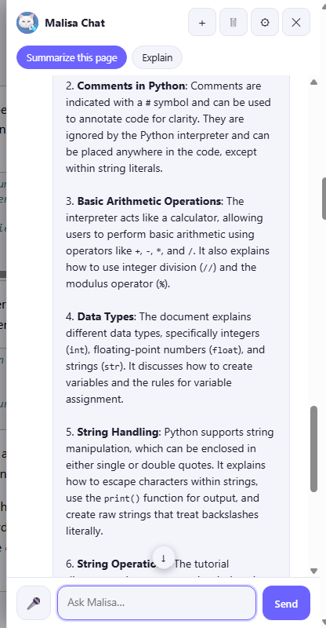
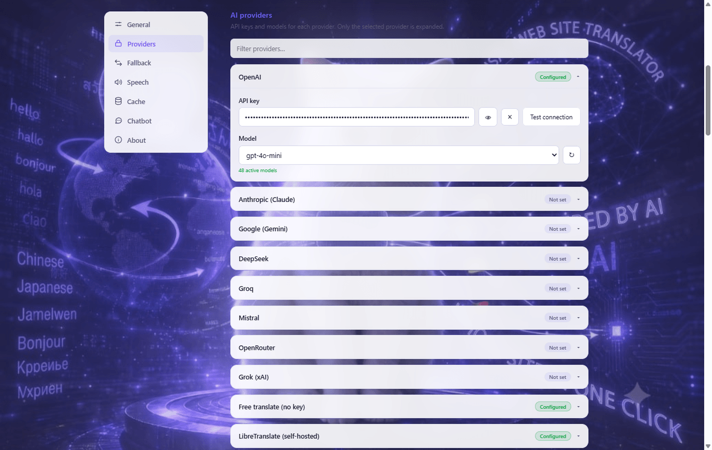
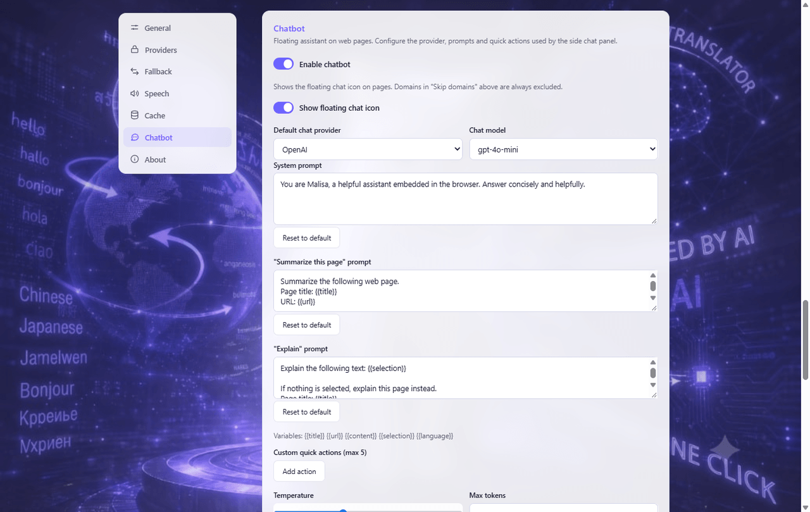

<table>
  <tr>
    <td width="300" valign="middle">
      
    </td>
    <td valign="middle">
      <h1>Malisa</h1>
      <p><strong>Read the web in your language. Ask questions, understand more, and listen when you prefer.</strong></p>
      <p>Malisa is a browser assistant that lives on the page you are reading. It can translate a whole page or just a passage, summarize long articles, explain unfamiliar text, and chat with you about what you are looking at — so you do not have to keep copying things into another app.</p>
      <p><sub>v2.5.6 · Chrome · Firefox 142+</sub></p>
    </td>
  </tr>
</table>

**[Features](#what-you-can-do) · [Screenshots](#screenshots) · [Getting started](#getting-started) · [Providers & costs](#providers-and-costs) · [Privacy](#privacy) · [Installation](#installation)** · [Build docs](docs/BUILD.md)

---

## What you can do

### Read in your language

Translate an entire page with one click, translate a passage you selected, and switch back to the original whenever you want. Translations are batched and cached, so long articles do not turn into a wall of requests — and a fallback provider can take over if your main one is rate-limited.

### Understand the important parts

Long article, dense documentation, unfamiliar terminology? Ask Malisa to **summarize** the page or **explain** a selected passage — in your language, in a few sentences instead of twenty minutes of reading.

### Ask Malisa

A chat panel sits beside the page (or floats as an icon you can drag). Ask questions, continue the conversation, and get answers that can take the current page into account when you allow it. Malisa remembers the thread while the tab is open, and you can delete individual messages or clear the history.

### Speak and listen

Dictate a question with the microphone, or have Malisa read translations and answers aloud. Browser voices work for free; cloud speech services are available when you configure them. Voice input depends on your browser — it works best in Chrome — and audio transcription needs a supported provider or the browser's own speech recognition.

### Make it yours

Choose your translation and chat providers, pick models, tune prompts and response language, and switch between light and dark themes. If you prefer, point Malisa at services you run yourself — Ollama for chat, LibreTranslate or a custom endpoint for translation, a self-hosted TTS server for speech.

## Who is Malisa for?

- **Students and self-directed learners** reading course material or papers in another language.
- **Anyone reading articles or documentation** published in a language they do not speak natively.
- **Developers** researching technical docs, changelogs, and Stack Overflow answers in English or other languages.
- **People who prefer listening** — Malisa can read pages and answers aloud.
- **Anyone facing a long or complex text** who wants the gist first and the details on demand.

These are everyday use cases, not promises — results depend on the providers you configure.

## A simple everyday workflow

1. Open a page you want to understand.
2. Translate it, or select a passage and translate just that.
3. Ask Malisa to summarize it or explain the tricky part.
4. Keep asking follow-up questions — or press **Listen** and let Malisa read the answer.

## Screenshots

Everything below is the real extension, version 2.5.6, running on the German Python tutorial at docs.python.org. Answers appear in the language you choose — in these shots, English.

**Selected-text translation** — select a passage, right-click, and choose Malisa's translate option to see the original and its translation side by side, with quick actions for follow-up questions and read-aloud.



**Ask Malisa about the page** — the chat panel answers questions with the page as context.



**Summarize** — one click turns a long page into a short summary in your language.



**Explain** — ask Malisa to explain a concept or passage in simpler terms.



**Settings** — providers, models, prompts, themes, speech, cache, and privacy controls live in one place. API keys are masked in the interface.





## Getting started

1. Install Malisa (see [Installation](#installation)).
2. Open **Settings** from the extension icon and accept the privacy notice.
3. Pick a translation provider — **MyMemory** works with no key for light use — and optionally add API keys for chat, better translation, or speech.
4. Translate a page, select some text, or click the floating Malisa icon to start chatting.

You do not need every provider configured. Start with the free defaults and add keys only for the features you actually use.

## Providers and costs

Malisa does not ship with a bundled AI service — **you choose who does the work**, and each provider has its own language coverage, limits, and pricing. Possessing an API key for a provider's web chat (for example a ChatGPT or Claude subscription) does **not** automatically give you API access; API usage is billed or limited separately by that provider.

### AI chat (questions, summaries, explanations)

OpenAI · Anthropic (Claude) · Google Gemini · DeepSeek · Groq · Mistral · OpenRouter · xAI (Grok) · **Ollama** (runs locally, free)

Several of these have free tiers — Groq, Google AI Studio, OpenRouter's `:free` models, and Mistral's free mode, for example — with their own rate limits. Check each provider's current terms; free-tier quotas and whether your prompts may be used for training vary by service.

### Translation

- **No key needed:** MyMemory (anonymous daily character limit, higher with an email) and an unofficial Google Translate endpoint used for quick translations — free but not a guaranteed service.
- **Free tiers / own key:** DeepL Free (monthly character quota), Azure Translator (free F0 tier), Google Cloud Translation (monthly quota), Yandex, Baidu.
- **Self-hosted:** LibreTranslate — run your own instance and point Malisa at it.

Machine-translation quality and supported languages differ between services; Malisa can fall back to a second provider if the first fails or is rate-limited.

### Speech and voice

- **Listen / read aloud:** the browser's built-in voices (free), or cloud voices via Google Cloud TTS, Gemini TTS, ElevenLabs, OpenAI TTS, Azure Speech, Amazon Polly, or a custom self-hosted endpoint.
- **Voice input:** your browser's speech recognition where available (in Chrome this uses Google's service — it is not offline), or audio transcription through OpenAI Whisper, Groq, or Mistral.

## Privacy

- Malisa has **no analytics, no tracking, and no telemetry** — your reading habits are not sent anywhere by the extension itself.
- Settings and API keys are stored locally in your browser profile (`browser.storage.local`). This is **not** an encrypted vault — anyone with access to your browser profile could read them.
- Page text, selections, and chat messages are sent **only to the provider you configured**, and only when you use a feature that needs it. Using your own API key does not keep data on your device — the provider still receives the content you ask it to process.
- Browser speech recognition is a browser feature, not something Malisa controls; in Chrome it uses Google's speech service.
- You can clear the translation cache and chat history in Settings, and remove stored API keys there at any time.

Full details: [PRIVACY.md](PRIVACY.md) and the in-product policy under `privacy/privacy.html`.

## Installation

Malisa is not yet published on the Chrome Web Store or Mozilla Add-ons — install it from source or the GitHub release packages for now.

**Chrome**

- Easiest: download `malisa-chrome-2.5.6.zip` from the [v2.5.6 release](https://github.com/Mapass75/Malisa---AI-web-site-Translator/releases/tag/v2.5.6), unzip it, then `chrome://extensions` → enable **Developer mode** → **Load unpacked** → select the unzipped folder.
- Or clone the repo and load `dist/chrome/` (or the repo root) the same way.

**Firefox**

- Download `malisa-firefox-2.5.6.xpi` from the same release. This package is **unsigned** — Mozilla signs add-ons during review — so for regular installation it must first be submitted to addons.mozilla.org, or:
- For testing: `about:debugging#/runtime/this-firefox` → **Load Temporary Add-on** → pick `dist/firefox/manifest.json` from a source checkout (requires Firefox 142+).

## For developers

The repo contains the shared source plus generated builds — there is no duplicated codebase for Firefox.

```
manifest.json      Chrome MV3 manifest (source of truth)
background/        service worker: providers, chat, TTS, transcription
content/           page translation, selection popup, chat panel (Shadow DOM)
popup/             quick-translate popup
options/           settings, providers, chatbot, speech, privacy consent
shared/            storage, cache, security, i18n, providers/, chat, tts, ...
privacy/           in-product privacy policy
scripts/           build-dist.mjs (packages), generate-icons.mjs
docs/              store-listing drafts, AMO notes, build docs, screenshots
 dist/chrome/      unpacked Chrome build (generated)
 dist/firefox/     unpacked Firefox build, gecko manifest (generated)
```

```bash
npm install                        # devDependency: sharp (icon generation only)
node scripts/build-dist.mjs        # builds dist/chrome, dist/firefox, release/*.zip
```

`manifest.json` sits at the root of every release ZIP. The build rejects forbidden file names (`nul`, `con`, …) and suspicious files (`.env*`, `*secret*`). Details: [docs/BUILD.md](docs/BUILD.md), [docs/CWS-LISTING.md](docs/CWS-LISTING.md), [docs/AMO-NOTES.md](docs/AMO-NOTES.md).

## License

MIT — see [LICENSE](LICENSE).
